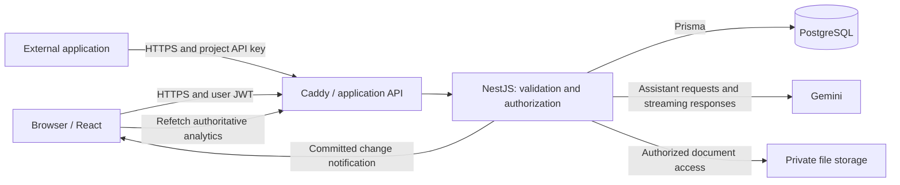

*This project has been created as part of the 42 curriculum by ynyamets, lfirmin, dinados-, mcamaren, falatrac.*

# TokenScope

**Collaborative LLM cost observability for engineering teams.**

## Description

TokenScope helps teams understand the usage and estimated cost of the language models used by their applications. External applications submit execution traces containing provider/model identifiers, workflow, token counts, latency and outcome. TokenScope stores those traces within a project, applies historical catalogue prices, and exposes the data through authenticated workspace APIs and project analytics.

Organizations group users and projects, with membership roles controlling access. The dashboard brings together usage and cost analytics, trace filtering, realtime updates, CSV/PDF exports, private project documents and a Gemini assistant.

TokenScope records **estimates, not provider invoices**. A provider name in a stored trace does not itself cause a request to that provider. The dashboard assistant and the standalone external demo make explicit provider calls. Evaluation fixtures use clearly identified synthetic prices.

## Team Information

The team combines development work with product, coordination and architecture responsibilities.

| Team member | 42 login | Role and responsibility |
|---|---|---|
| Yawovi Leon Nyametso | `ynyamets` | Developer and Technical Lead/Architect — to confirm with the team. |
| Léo Firmin | `lfirmin` | Developer. **To complete:** responsibilities and any additional role. |
| Dina Maria Dos Santos Monteiro | `dinados-` | Developer. **To complete:** responsibilities and any additional role. |
| Monica Francesca Camarena Pucuhuanca | `mcamaren` | Developer. **To complete:** responsibilities and any additional role. |
| Fatin Alatrach | `falatrac` | Developer and Product Owner — to confirm with the team. Helps clarify the product's value and keep its documentation aligned with user needs and delivered features. |

**To confirm:** Project Manager and Product Owner assignments.

## Project Management

Work is organized through Linear tickets identified by `TSE-…`, Git branches and GitHub pull requests. WhatsApp is used for team communication. The repository workflow starts ticket branches from `develop`, requests review, and reserves `main` for stable milestone releases. See [Repository Workflow](docs/REPOSITORY_WORKFLOW.md).

Feature documentation, setup instructions and the evaluation guide provide a shared reference for the team.

**To complete with the team:** how meetings, priorities, task assignments and reviews were organized.

## Technical Stack

Exact dependency versions are recorded in the frontend and backend `package-lock.json` files.

| Layer | Technologies | Purpose |
|---|---|---|
| Frontend | React 19, TypeScript, Vite 8, React Router | Component-based screens, typed API integration and browser navigation. |
| Styling | Tailwind CSS 4, shared UI components | Consistent responsive layouts, typography and interactive controls. |
| Backend | NestJS 11, TypeScript, Node.js 24 | Modules, controllers, validation and shared authentication/authorization. |
| Persistence | PostgreSQL 16, Prisma 7 | Relational organizations/memberships/projects, foreign keys, transactions and migrations. |
| Authentication | JWT, Argon2 password hashing | Signed user access tokens and password verification; project API keys form a separate mechanism. |
| Realtime | Socket.IO, Vite/Caddy proxying | Authorized project-change notifications after committed writes. |
| Deployment | Docker Compose, Make, Caddy 2 | One application stack with development and trusted-HTTPS evaluation modes. |
| Tests | Jest, Vitest, Testing Library, Playwright | Backend, frontend and browser tests. |
| Provider integration | Gemini | Context-aware dashboard answers and the independent Chat/Translation demo. |

The application has a modular backend and a separate browser frontend. PostgreSQL supports the relationships between users, organizations and projects, as well as transactional trace writes. Prisma provides typed database access and migrations. **To complete with the team:** the reasons behind the main technology choices and any alternatives considered.

## Architecture



The diagram shows the HTTPS evaluation setup. Development uses Vite's proxy.

- **Browser to API:** shared HTTP helpers carry the user session. NestJS checks the user's current membership and permissions for each resource.
- **External client to API:** a project API key scopes trace operations to its active project. Workspace routes use user authentication instead.
- **Trace to dashboard:** the backend computes analytics and announces committed changes. The browser then fetches updated totals through the API, keeping charts and summaries consistent.
- **Exports:** CSV and PDF files are generated in the browser from the displayed data snapshot, preserving the selected dates and filters.
- **Assistant:** the browser sends a question with the selected dates and filters. The backend builds an authorized snapshot of the project's analytics and streams a Gemini answer. Each new request uses its own snapshot; uploaded documents are excluded from the context.
- **Private documents:** authenticated project routes check access before returning files. Archiving a parent organization or project retains its data. Deleting an individual document removes its metadata and schedules file cleanup.

Detailed boundaries: [Evaluation Architecture](docs/EVALUATION_ARCHITECTURE.md), [API](docs/API.md), [Security](docs/SECURITY.md).

## Database Schema

The [Prisma schema](backend/prisma/schema.prisma) defines the models, and [migrations](backend/prisma/migrations) track database changes. [Data Model](docs/DATA_MODEL.md) explains the relationships and constraints in more detail.

| Entity | Important fields and types | Relationships / purpose |
|---|---|---|
| `User` | `id: String`, unique `email`, `passwordHash`, `displayName` | Has memberships; can create keys and upload documents. |
| `Organization` | `id`, unique `slug`, `name`, nullable `archivedAt: DateTime` | Contains memberships and projects. |
| `Membership` | `userId`, `organizationId`, `role: OWNER/ADMIN/MEMBER` | Links a user to an organization; pair is unique. |
| `Project` | `organizationId`, `name`, `slug`, optional description/archive timestamp | Belongs to one organization; slug is unique within it. |
| `ApiKey` | `projectId`, unique `keyHash`, display prefix, creation/revocation dates | Stores a digest rather than the plaintext project credential. |
| `ModelPrice` | provider/model, `effectiveFrom`, rates `Decimal(18,6)`, synthetic flag | Historical price versions; provider/model/effective date is unique. |
| `Trace` | project/external ID, integer tokens/latency, status, dates, JSON metadata, costs `Decimal(24,12)` | References a price version and stores copied historical rates. Deleted rows retain the external-ID reservation. |
| `ProjectDocument` | project/uploader IDs, storage key, MIME type, byte size, SHA-256 | Stores metadata for private project files and links each upload to its project and uploader. |
| `FileDeletionJob` | storage key, attempts, next-attempt date, error code | Tracks file cleanup after document metadata has been deleted. |

Organization/project archive removes ordinary access while retaining related records. There is no application restore feature in this MVP. User accounts and unrelated organizations remain usable.

## Features List

| Feature | What it provides | Contributors |
|---|---|---|
| Public landing page | Responsive product introduction, audience and workflow explanations, illustrative preview and authentication links. | Fatin; shared UI contribution details to complete. |
| Authentication and workspaces | Signup/signin, organizations, projects and membership-based access. | **To complete:** individual contributions. |
| Organization archive | Owner confirmation, retained records and access-loss handling. | **To complete:** individual contributions. |
| HTTPS deployment | A single Docker Compose stack served through Caddy with a trusted local certificate. | **To complete:** individual contributions. |
| Project API keys and trace API | Project-scoped credentials, key revocation, trace creation, retrieval, replacement and deletion, plus historical cost estimates. | **To complete:** individual contributions. |
| Trace Explorer | Combined filters, sorting, pagination and trace details. | **To complete:** individual contributions. |
| Analytics dashboard | Usage, estimated costs, latency and errors, with date/filter selection, realtime refresh and CSV/PDF exports. | **To complete:** individual contributions. |
| Private documents | Validated PDF, TXT and Markdown uploads, progress feedback, preview, download and deletion. | **To complete:** individual contributions. |
| Dashboard assistant | Streamed Gemini answers based on authorized project analytics, with Stop, error handling and rate limits. | **To complete:** individual contributions. |
| Privacy Policy and Terms of Service | Public English legal pages accessible without signing in, linked through the public navigation. | Fatin. |
| External Chat and Translation demo | A standalone application that makes real Gemini calls and sends usage traces to two separate TokenScope projects through a shared wrapper. | Fatin. |

See [Individual Contributions](#individual-contributions) for each teammate's responsibilities, tools and challenges.

## Modules

Our selected modules total **16 points**, above the subject's minimum of 14. They support TokenScope's core workflow: collecting traces, understanding spending and collaborating within a shared workspace. The [evaluation guide](docs/DEMO.md#mandatory-requirements) also covers the mandatory project requirements.

| Module | Type / points | How it fits TokenScope |
|---|---|---|
| Framework for both frontend and backend | Major / 2 | React and NestJS structure the browser application and API. |
| ORM | Minor / 1 | Prisma provides typed database access, migrations and PostgreSQL persistence. |
| Organization system | Major / 2 | Organizations, memberships and roles give teams a shared workspace with controlled access. |
| Public API | Major / 2 | Project keys, quotas and five trace operations allow external applications to submit and manage their usage data. |
| Realtime features | Major / 2 | Authorized Socket.IO notifications keep project views up to date after data changes. |
| Advanced analytics dashboard | Major / 2 | Interactive charts, date and filter selection, realtime refresh and exports help teams investigate usage and spending. |
| Complete LLM system interface | Major / 2 | The Gemini assistant explains project analytics through streamed responses, with error handling and rate limits. |
| File upload and management | Minor / 1 | Private PDF, TXT and Markdown files can be uploaded, previewed, retrieved and deleted within a project. |
| Advanced search | Minor / 1 | Combined trace filters, sorting and pagination help users find relevant executions. |
| Additional browsers | Minor / 1 | Firefox and Edge complement Chrome. Browser versions and compatibility results are recorded in the evaluation guide. |
| **Total** | **16** | **Six major and four minor modules.** |

**To complete with the team:** contributors for each module.

## Instructions

### Prerequisites

On the host: Git, Docker with its daemon running, Docker Compose v2 with `--wait` support, Make, curl and OpenSSL. Containers use Node.js 24, PostgreSQL 16 and Caddy 2; host Node.js is unnecessary for container startup. **To complete:** tested host and Docker Compose versions.

### Start the HTTPS evaluation application

From your chosen parent directory on the host:

```sh
git clone --branch develop https://github.com/lynyam/tokenscope.git
cd tokenscope
make eval-up
```

`make eval-up` prepares `.env` from `.env.example` when absent, generates a missing JWT secret, builds the application, applies committed migrations and checks HTTPS readiness. It does not seed evaluation accounts or traces. Expected completion: `TokenScope is running: https://localhost:8443`.

Local `.env` values are private. Replace the template database password for your environment and keep `DATABASE_URL` consistent. Never commit generated credentials, project keys or a demo password.

Trust the exported local Caddy CA once. On macOS, from the repository root:

```sh
sudo security add-trusted-cert -d -r trustRoot \
  -k /Library/Keychains/System.keychain \
  .local/eval/caddy-root.crt
```

This changes the host trust store and requires administrator authorization. Restart the browser and open `https://localhost:8443` without bypassing a certificate warning. Other systems and browser-specific trust stores are covered in [Local Development](docs/LOCAL_DEVELOPMENT.md#trust-the-local-certificate).

Verify database readiness from the host:

```sh
curl --fail --show-error --max-time 10 \
  --cacert .local/eval/caddy-root.crt \
  https://localhost:8443/api/v1/health/db
```

Expected: HTTP 200 with `{"status":"healthy"}`. Create an account through the signup page, or use the evaluation accounts configured with the evaluation dataset.

### Evaluation data, provider setup and tests

- **Evaluation data:** the [fixture documentation](fixtures/evaluation/README.md) describes the dataset and expected analytics. **To complete with the team:** the dataset setup command and instructions for supplying the evaluation-account password.
- **Dashboard assistant:** configure Gemini credentials and the model on the backend. Provider credentials stay on the server. **To complete with the team:** the configuration instructions.
- **External demo:** its separate backend uses Gemini credentials and two TokenScope project API keys: one for Demo Chat and one for Demo Translation.
- **Tests:** see [Local Development](docs/LOCAL_DEVELOPMENT.md) for commands and [the evaluation guide](docs/DEMO.md) for demonstration steps and expected results.
- **Shutdown:** run `make stop` from the repository root to stop the application while keeping its data. `make start` resumes it. `make clean` removes containers and the network while retaining volumes. `make fullclean` also deletes volumes, including the database and local certificate authority.

## Individual Contributions

| Contributor | Tickets | Contributions | Challenges and learning | Tools |
|---|---|---|---|---|
| Yawovi Leon Nyametso | To complete. | Architecture, backend authorization, traces, pricing, analytics and realtime integration — to confirm. | To complete. | To complete. |
| Léo Firmin | To complete. | Shared UI, dashboard, exports and assistant frontend — to confirm. | To complete. | To complete. |
| Dina Maria Dos Santos Monteiro | To complete. | HTTPS setup, organization archive, API-key UI, Trace Explorer and documents — to confirm. | To complete. | To complete. |
| Monica Francesca Camarena Pucuhuanca | To complete. | Authentication and assistant backend — to confirm. | To complete. | To complete. |
| Fatin Alatrach | TSE-55, TSE-82, TSE-86, TSE-83 | Built the landing and legal pages, the external Chat/Translation demo with Gemini and trace reporting, and the project documentation. | Joined after the idea and architecture were established. Learned the codebase and earlier decisions with the team's support, then contributed through focused tickets. | React, Tailwind CSS, Node.js, Gemini API, Vitest/Jest, Markdown, Git/GitHub. |

## Resources

- [React documentation](https://react.dev/learn) — component and state concepts.
- [NestJS documentation](https://docs.nestjs.com/) — backend modules and request handling.
- [Prisma documentation](https://www.prisma.io/docs) — schema, client and migrations.
- [PostgreSQL documentation](https://www.postgresql.org/docs/) — relational database reference.
- [Docker Compose documentation](https://docs.docker.com/compose/) — container application configuration.
- [Gemini API documentation](https://ai.google.dev/gemini-api/docs) — provider requests, response handling and configuration.
- **ft_transcendence subject v21.1** — project requirements, modules and README guidelines. **To add:** a shared link to the subject.
- [TSE-83](https://linear.app/move2/issue/TSE-83) — documentation ticket (team access required).

### AI Usage

Fatin mainly used ChatGPT and occasionally Gemini. AI helped her understand tickets, learn unfamiliar concepts, interpret error messages and catch up with the team's existing work. For TSE-86, she used AI to help build the independent Chat/Translation demo, including the Gemini integration, shared `callWithTrace` wrapper, separate project credentials, usage normalization and trace-delivery feedback, as well as the setup and test documentation. AI also helped prepare the project documentation.

**To complete — other teammates:** the AI tools they used, the tasks and features involved, and how they reviewed and tested the results.

## Product Scope and Limitations

TokenScope provides estimated LLM costs rather than billing totals. Its assistant answers questions using project analytics; uploaded documents and previous conversations are not included. Archived organizations and projects retain their data, but cannot be restored through the application.

## Documentation Map

| Document | Purpose |
|---|---|
| [Local Development](docs/LOCAL_DEVELOPMENT.md) | Setup, commands, configuration and shutdown. |
| [Evaluation guide](docs/DEMO.md) | Setup for the demonstration, feature walkthroughs, expected results and test reports. |
| [Evaluation Architecture](docs/EVALUATION_ARCHITECTURE.md) | Shared architecture decisions and feature responsibilities. |
| [API](docs/API.md) / [Public API](docs/PUBLIC_API.md) | HTTP, realtime and streaming contracts; implemented public trace API. |
| [Data Model](docs/DATA_MODEL.md) / [Security](docs/SECURITY.md) | Persistent invariants, authorization and lifecycle boundaries. |
| [Sprint 1 Architecture](docs/SPRINT_1_ARCHITECTURE.md) / [Onboarding](docs/ONBOARDING.md) | Sprint 1 architecture, original product plan and team onboarding. |
| [Repository Workflow](docs/REPOSITORY_WORKFLOW.md) / [ADRs](docs/ADR/README.md) | Collaboration rules and architectural decisions. |
